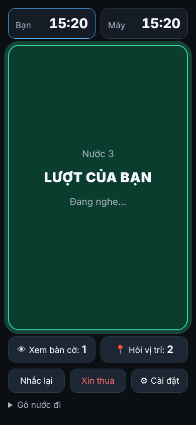

# Cờ mù — chơi cờ bịt mắt bằng giọng nói với Stockfish

Trang web cho bạn **đánh cờ mù** (blindfold chess) với máy:

- Bàn cờ **bị ẩn** trong suốt ván. Bạn bịt mắt thật.
- Bạn **nói nước đi** (tiếng Việt hoặc tiếng Anh). Máy đọc lại để bạn xác nhận, rồi đi.
- Máy là **Stockfish 19**, chạy ngay trong trình duyệt, sức mạnh chỉnh từ **1000 đến 2500 Elo**.
- Mỗi ván có **3 quyền trợ giúp**: 1 lần tháo bịt mắt xem bàn cờ 10 giây, 2 lần hỏi vị trí các quân.

Không cần cài đặt, không cần server, không cần tài khoản. Mở trang là chơi.



## Chơi thế nào

1. Mở trang bằng **Chrome, Edge** (máy tính hoặc Android) hoặc **Safari** (iPhone/iPad, iOS 14.5+).
2. Chọn sức mạnh máy, màu quân, đồng hồ. Bấm **Bắt đầu ván đấu**, cho phép dùng micro.
3. Bịt mắt. **Chạm bất kỳ đâu trên màn hình** (hoặc nhấn phím cách trên máy tính), nghe tiếng bíp rồi nói nước đi.
4. Máy đọc lại: *"Mã ép 3. Đúng không?"*. Nói **"đúng"** để đi, **"sai"** để nói lại.
5. Máy nghĩ rồi đọc nước của nó, ví dụ *"Tốt e 5."*

### Cách nói nước đi

| Bạn muốn | Nói được |
|---|---|
| Tốt lên e4 | `e4`, `e bốn`, `tốt e4`, `e2 e4`, `echo four` |
| Mã lên f3 | `mã f3`, `mã ép ba`, `ngựa f3`, `knight f3`, `g1 f3` |
| Tốt e ăn d5 | `e ăn d5`, `tốt ăn d5`, `e takes d5`, `e d5` |
| Hai mã cùng tới d2 | `mã bê đến dê hai`, `mã b d2`, `knight b d2` |
| Hai xe cùng tới a3 | `xe 1 a3`, `xe một a ba` |
| Nhập thành | `nhập thành gần`, `nhập thành xa`, `castle short`, `O-O` |
| Phong cấp | `e8 phong hậu`, `e8 phong mã`, `e8 equals knight` |

Mẹo:
- Chữ cột nói kiểu Việt: **a, bê, xê, dê, e, ép, gờ, hát**, hoặc NATO: **alpha, bravo, charlie, delta, echo, foxtrot, golf, hotel**. Kiểu NATO ít bị nghe nhầm nhất.
- Nếu nhiều quân cùng đi được tới một ô, máy **không tự đoán** mà hỏi lại bạn.
- Nói "e5" mà chỉ có quân khác (không phải tốt) đi tới được thì máy hiểu là quân đó.

### Lệnh bằng giọng nói

| Lệnh | Nói | Ghi chú |
|---|---|---|
| Xem bàn cờ 10 giây | `tháo bịt mắt`, `xem bàn cờ`, `show board` | **1 lần/ván**. Nói `xong` hoặc chạm để che sớm. Đồng hồ vẫn chạy. |
| Vị trí các quân | `quân ở đâu`, `vị trí quân`, `where are the pieces` | **2 lần/ván**. Đọc mọi quân không phải tốt, bên bạn trước. |
| Nhắc lại nước máy | `nhắc lại`, `máy vừa đi gì` | |
| Nước bạn vừa đi | `tôi vừa đi gì` | |
| Đọc lại ván | `đọc lại ván`, `lịch sử` | Ván dài thì đọc 10 nước gần nhất. |
| Thời gian | `thời gian`, `đồng hồ` | |
| Tạm dừng / tiếp tục | `tạm dừng` / `tiếp tục` | Khi có đồng hồ. |
| Cầu hòa | `cầu hòa` | Máy đồng ý khi đã qua nước 20 và thế cờ cân bằng. |
| Xin thua | `xin thua` | Máy hỏi lại để chắc chắn. |
| Trợ giúp | `trợ giúp`, `help` | |

Phím tắt trên máy tính: **Space** nói, **P** xem bàn cờ, **L** vị trí quân, **R** nhắc lại, **Esc** hủy xác nhận.

### Sau ván

Bàn cờ hiện lại, có danh sách nước đi, nút xem lại từng nước, **tải PGN**, **sao chép PGN**, **phân tích trên Lichess**.

Ván đang chơi được lưu sau mỗi nước. Lỡ tải lại trang hoặc tắt trình duyệt, lần sau mở lại sẽ có nút **Tiếp tục**.

## Đưa lên mạng (GitHub Pages)

Không có bước build. Repo này chính là trang web.

1. Vào repo trên GitHub → **Settings** → **Pages**.
2. **Source**: *Deploy from a branch*. **Branch**: chọn nhánh (ví dụ `main`), thư mục `/ (root)`. Bấm **Save**.
3. Chờ khoảng 1 phút, trang sẽ có ở `https://<tên-tài-khoản>.github.io/<tên-repo>/`.

GitHub Pages có HTTPS sẵn, và micro chỉ hoạt động trên HTTPS. Mọi host tĩnh khác (Netlify, Cloudflare Pages…) cũng dùng được.

## Chạy trên máy mình

Phải chạy qua HTTP, **không mở trực tiếp file** `index.html` (trình duyệt chặn module và Web Worker khi mở file):

```bash
python3 -m http.server 8080
# hoặc: node e2e/helpers/server.js 8080
```

Mở `http://localhost:8080`. Trên `localhost`, trình duyệt vẫn cho dùng micro mà không cần HTTPS.

## Kiểm thử

```bash
npm test            # test đơn vị: parser, đọc nước đi, luật ván, đồng hồ, Stockfish thật (Node ≥ 18)
npm run test:e2e    # test trình duyệt bằng Playwright + Chromium (micro và giọng đọc giả)
npm run test:all    # cả hai
```

Test trình duyệt cần Playwright: `npm i -D playwright && npx playwright install chromium` (môi trường cloud đã có sẵn).

Công cụ thêm:
- `node tools/measure-strength.mjs`: đo độ mạnh từng mức Elo.
- `node tools/screenshots.mjs`: chụp lại ảnh màn hình vào `docs/screenshots/`.

Kết quả kiểm thử gần nhất: [TEST-REPORT.md](TEST-REPORT.md).

## Cấu trúc

```
index.html, css/, js/          trang web (JavaScript thuần, ES modules, không build)
js/speech/                     hiểu câu nói (normalize, parser), đọc nước đi, bọc API giọng nói
js/ui/                         các màn hình
js/i18n/vi.js                  mọi chữ tiếng Việt
vendor/                        Stockfish 19.0.1 (lite, 1 luồng) và chess.js 1.4.0, tải sẵn
tests/  e2e/                   test đơn vị và test trình duyệt
PLAN.md  CLAUDE.md             đặc tả và quy ước
```

## Giới hạn đã biết

- **Firefox** chưa hỗ trợ nhận dạng giọng nói: trang báo rõ và cho **gõ nước đi**.
- Nhận dạng giọng nói của Chrome thường cần **internet** (giọng nói được xử lý trên máy chủ của Google).
- Nếu máy chưa có **giọng đọc tiếng Việt**, máy vẫn đọc nhưng phát âm lạ. Cài giọng tiếng Việt trong cài đặt hệ điều hành để nghe rõ hơn.
- Mức **1000–1300** là ước lượng: Stockfish chỉ hỗ trợ chính thức từ 1320. Xem cách mô phỏng trong `js/elo.js`.

## Giấy phép và ghi công

- Trang web phân phối kèm Stockfish (GPLv3), nên khi chia sẻ lại trang cần tuân thủ điều khoản GPLv3 (công khai mã nguồn, giữ giấy phép).
- [Stockfish](https://stockfishchess.org/) 19, bản WebAssembly [stockfish.js](https://github.com/nmrugg/stockfish.js) của Nathan Rugg: **GPLv3**, xem `vendor/stockfish/LICENSE`.
- [chess.js](https://github.com/jhlywa/chess.js) 1.4.0: **BSD-2-Clause**, xem `vendor/chess.js/LICENSE`.
- Bộ quân cờ **cburnett** (Colin M.L. Burnett), lấy từ [Lichess](https://github.com/lichess-org/lila): **CC BY-SA 3.0**.
