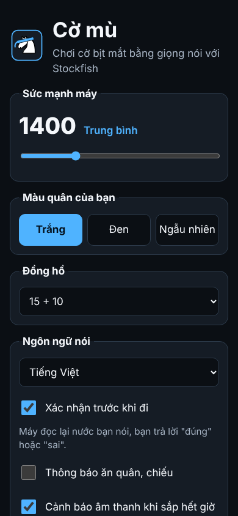
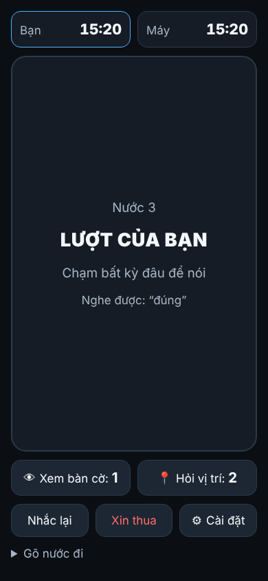
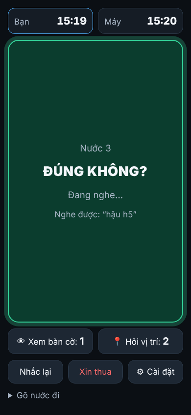
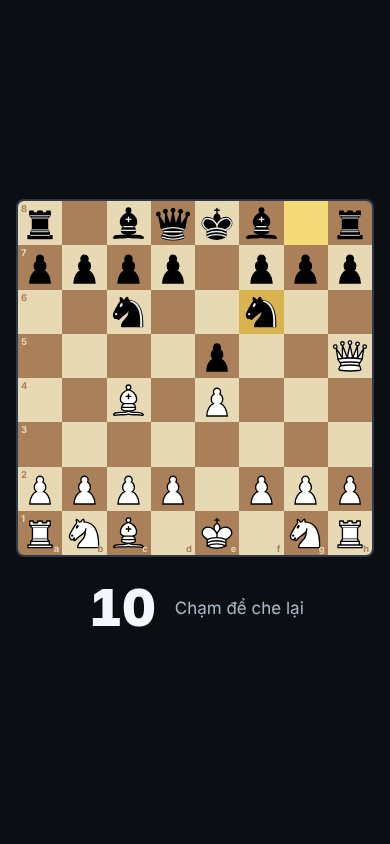
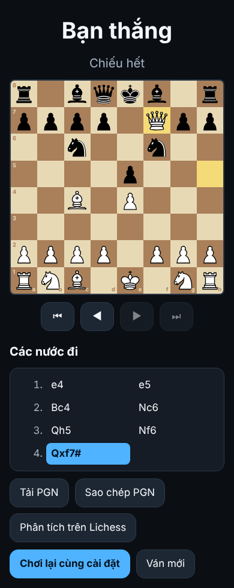

# Báo cáo kiểm thử — Cờ mù

- **Ngày:** 25/10/2026 (lượt 2: rà soát lại toàn bộ và sửa lỗi)
- **Mã nguồn:** nhánh `claude/optimistic-brown-wodztk`, commit chứa báo cáo này
- **Môi trường:** Node 22.22.0, Playwright 1.63.0, Chromium 153.0.8010.12 (headless), Linux

## Tóm tắt

| Lớp | Lệnh | Kết quả | Thời gian |
|---|---|---|---|
| 1. Test đơn vị | `npm test` | **416/416 đạt** | ~30 giây |
| 2. Test trình duyệt (E1–E20 + 38 kịch bản bổ sung) | `npm run test:e2e` | **58/58 đạt** | |
| 3. Ván đấu tự động trọn vẹn (Elo 1000 / 1800 / 2500) | (trong `npm run test:e2e`) | **3/3 đạt** | |
| Tổng lớp 2 + 3 | `npm run test:e2e` | **61/61 đạt**, chạy lặp lại 2 lượt, không có test chập chờn | ~2 phút/lượt |
| 4. Ảnh màn hình | `node tools/screenshots.mjs` | 12 ảnh (điện thoại + máy tính), đã xem lại | |

Sau mỗi test trình duyệt, bộ test tự kiểm tra hai điều: **không có lỗi console** và **micro không bao giờ mở khi máy đang đọc, đang nghĩ hoặc chưa tới lượt người chơi** (E17).

## Lượt 2: cách rà soát và những lỗi đã sửa

Cách làm: tự đọc lại toàn bộ mã nguồn, đồng thời 3 nhóm rà soát độc lập (bộ điều khiển ván đấu; lớp giọng nói; giao diện và tương thích trình duyệt) chỉ đọc và báo cáo, mỗi lỗi kèm kịch bản cụ thể. Mỗi lỗi sửa xong đều có test đi kèm (68 test đơn vị và 19 test trình duyệt mới).

### Lỗi nặng (làm sai kết quả ván hoặc không chơi được)

| # | Lỗi | Đã sửa |
|---|---|---|
| 1 | Máy đi nước kết thúc ván (chiếu hết, pat, hòa) khi người chơi chỉ còn vài giây: đồng hồ người chơi chạy trong lúc máy đọc nước → "Bạn hết giờ. Máy thắng." đè lên kết quả thật (ván hòa thành thua) | Nước kết thúc ván thì dừng đồng hồ; với nước thường, đồng hồ người chơi chỉ chạy sau khi nghe xong nước của máy |
| 2 | Bản Stockfish đi kèm cần WebAssembly SIMD: **Safari/iOS trước 16.4** không chạy được, mà thông báo lại bảo "tải lại trang" | Phát hiện SIMD lúc mở trang; báo đúng: "cần Safari/iOS 16.4 trở lên, Chrome 91…"; README/PLAN ghi đúng yêu cầu |
| 3 | Kết quả nhận dạng tới **muộn** (sau khi micro đã tự đóng) vẫn được xử lý: có thể thực hiện nước đi trong lúc một phiên micro mới đang mở, hoặc micro nghe chính giọng máy đọc nước rồi hiểu thành nước của người chơi | Phiên micro đã đóng bỏ qua mọi kết quả/lỗi tới sau |
| 4 | Từ máy không hiểu bị **bỏ qua im lặng**: "tượng b3" nghe nhầm thành "tương bê ba" → máy đi tốt b3 (nếu tắt xác nhận thì đi sai không báo) | Câu có từ lạ mà chỉ còn ô đến → "Không hiểu. Nói lại." |

### Lỗi vừa (gây kẹt, nhầm lẫn hoặc phiền)

| # | Lỗi | Đã sửa |
|---|---|---|
| 5 | Stockfish hỏng (worker chết) giữa ván hoặc lúc bắt đầu ván → ván đứng im ở "MÁY ĐANG NGHĨ…" hoặc màn hình trống, không có tiếng; lệnh chờ worker treo 30 giây | Worker lỗi → từ chối ngay; tự khởi động lại Stockfish một lần; vẫn hỏng → đọc lỗi, dừng đồng hồ, về màn hình chính (ván đã lưu) |
| 6 | Hẹn giờ dự phòng của giọng đọc tính từ lúc **gọi** đọc, không phải lúc bắt đầu đọc: giọng online khởi động chậm → micro mở khi loa còn đang hỏi "…đúng không?" → nghe lại chính câu đó → "không" → hủy nhầm | Tính từ `onstart` của câu đọc; không bắt đầu được thì bỏ qua sau 5 giây |
| 7 | Chờ "đúng/sai": phương án nhận dạng thứ 2 ("dê bốn") đè lên "đúng" ở phương án 1 → hỏi lại nước khác | Chỉ lấy nước từ phương án xếp trước phương án chứa "đúng/sai" |
| 8 | Cảnh báo giờ: "Còn một phút" lặp lại sau mỗi lần cộng giây (15+10); sau khi sửa lại làm bíp 10 giây cuối không lặp | Mốc 60/30 giây chỉ lặp khi giờ tăng ≥ 60 giây; bíp 10 giây cuối lặp ngay khi vượt mốc |
| 9 | Ctrl+L / Cmd+P / Alt+R bị hiểu là phím tắt L/P/R → tiêu mất quyền xem bàn cờ, hỏi vị trí | Bỏ qua tổ hợp có Ctrl/Cmd/Alt và phím giữ |
| 10 | Safari trả kết quả tạm (isFinal=false) dù đã tắt; `onend` đôi khi không tới sau stop/abort → micro "kẹt" mãi | Dùng kết quả tạm khi không có kết quả cuối; hẹn giờ tự dọn phiên |
| 11 | Chrome: utterance bị dọn rác → không bao giờ bắn `onend`; `cancel()` rồi `speak()` ngay bị nuốt câu; kẹt ở trạng thái "paused" sau khi ẩn tab | Giữ tham chiếu utterance; chờ 150 ms sau cancel; `resume()` trước khi đọc |
| 12 | Trình duyệt không có `<dialog>`: form cài đặt hiện lù lù giữa màn chơi, bấm "Đóng" tải lại trang | CSS ẩn dialog khi chưa mở; tự xử lý submit |
| 13 | Tiếng bíp im lặng khi iOS tạm ngưng AudioContext lúc bật micro | `resume()` trước mỗi tiếng bíp; lỗi Web Audio không làm hỏng xử lý câu nói |
| 14 | Bíp "đang nghe" phát ngay khi gọi `start()`, trước khi micro thật sự thu (100–500 ms) → mất âm tiết đầu ("mã ép ba" → "ép ba") | Bíp khi trình duyệt báo bắt đầu thu (`onaudiostart`), dự phòng 500 ms |
| 15 | iOS từ chối micro tự mở khi chờ "đúng/sai" → app báo nhầm "mất quyền micro" | Im lặng, màn hình ghi "Chạm để trả lời" |

### Lỗi nhỏ

Đồng hồ tràn ở màn 320 px; bàn cờ khi "tháo bịt mắt" bị cắt trên điện thoại nằm ngang; "Sao chép PGN" thất bại không báo; link tải PGN bị thu hồi sau 1 giây (Firefox/Safari tải hỏng) và tải file từ web app iOS không ổn định (nay ưu tiên bảng chia sẻ); Enter trong ô số của đồng hồ tùy chỉnh bắt đầu ván; danh sách nước đi không cuộn tới nước đang xem; vùng an toàn iPhone bị tính hai lần làm màn chơi cuộn; cảnh báo trong ván nằm ở màn hình cài đặt đang ẩn; bàn cờ `role="img"` che mất tên quân với trình đọc màn hình; `<title>` rỗng và không có `<noscript>`; giọng đọc đã chọn bị xóa khi danh sách giọng chưa tải; phóng to hai ngón trong ván; dữ liệu localStorage hỏng làm app không mở hoặc crash khi kết thúc ván; bấm đồng hồ khi đã hết giờ không bị xử thua; PGN ván 0 nước thiếu dòng trống; điểm chặn trên/dưới của Stockfish bị dùng làm điểm thật; "nhập thành vua/hậu", "vâng", "dạ" chưa được hiểu; "dung" (không dấu) bị hiểu là "sai"; nghe thấy tiếng nhưng không nhận ra chữ bị báo là "không nghe thấy gì"; nhiều đoạn kết quả bị bỏ mất đoạn đầu; chế độ nghe liên tục bíp liên tục; thiếu gợi ý "chạm rồi nói tiếp tục" khi tạm dừng; gõ tay không dùng được khi tạm dừng/chờ xác nhận; phím cách khi focus ở nút khác lại bấm nút đó; chạm vùng đồng hồ không mở micro; cầu hòa trừ giờ người chơi; "Chơi lại" không giữ đúng cài đặt ván cũ; không bíp lỗi khi micro không mở được sau cú chạm; `:has()` và `dvh`/`aspect-ratio` không có fallback cho Safari cũ.

## Lớp 1 — Test đơn vị (416)

| File | Số test | Nội dung |
|---|---|---|
| `tests/parser.test.js` | 291 | 253 câu nói mẫu (tiếng Việt, tiếng Anh, NATO, tọa độ, SAN, phân biệt quân, ăn quân, bắt tốt qua đường, nhập thành, phong cấp, lệnh, từ lạ, từ đệm, câu rác); chế độ xác nhận (kể cả "vâng", "dạ", không dấu); nhiều phương án nhận dạng; **kiểm tra vòng**: mọi nước hợp lệ trong ~1.000 thế cờ, máy đọc ra rồi parser phải hiểu lại đúng nước đó và chỉ nước đó (4 cách đọc) |
| `tests/engine.test.js` | 28 | Stockfish thật trong Node: 4 mức × 5 thế cờ, hết nước, đánh giá thế cờ, chiếu hết 1 nước, dòng `info` (kể cả điểm chặn), chọn nước mức thấp, worker lỗi → từ chối ngay, phát hiện SIMD |
| `tests/speak-move.test.js` | 21 | Đọc nước đi: cả hai chế độ thông báo ăn quân, NATO, đọc vị trí quân |
| `tests/game.test.js` | 16 | Mọi kiểu kết thúc ván, khôi phục ván, PGN (kể cả ván 0 nước) |
| `tests/normalize.test.js` | 14 | Bỏ dấu, dấu thanh kiểu cũ, tách cụm dính, xung đột "xe"/"b", từ đệm, từ lạ |
| `tests/recognition.test.js` | 14 | Lớp bọc micro với trình duyệt giả: kết quả tạm/cuối, `onend` không tới, abort, lỗi quyền, start() ném lỗi, kết quả tới muộn, nhiều đoạn, nomatch, thời điểm "đang thu" |
| `tests/clock.test.js` | 9 | Trừ giờ, increment, tạm dừng, hết giờ (kể cả khi bấm đồng hồ lúc đã hết giờ), lưu/khôi phục |
| `tests/tts.test.js` | 7 | Hàng đợi giọng đọc với trình duyệt giả: `onend`, hẹn giờ dự phòng tính từ `onstart`, watchdog, cancel, lỗi đọc, chọn giọng, chia câu |
| `tests/elo.test.js` | 6 | Mọi mức 1000→2500 hợp lệ; mức < 1320 không mạnh hơn 1320 |
| `tests/hints.test.js` | 6 | 1 lần xem, 2 lần hỏi vị trí, lưu/khôi phục, dữ liệu hỏng |
| `tests/storage.test.js` | 4 | Cài đặt/ván lưu: bản ghi hỏng, giá trị lạ, localStorage bị chặn |

## Lớp 2 — Test trình duyệt (58)

Micro và giọng đọc được thay bằng bản giả điều khiển từ test (`e2e/helpers/fakes.js`); một test dùng giọng đọc **thật** của Chromium headless (không có giọng → bắn lỗi) để chắc app không kẹt. Stockfish chạy thật bằng WebAssembly.

| Nhóm | Kịch bản | Kết quả |
|---|---|---|
| E1–E8, E16, E18, E20 (`basic`) | Mở trang, bắt đầu, bàn cờ ẩn, nói/xác nhận/hủy, nước không hợp lệ, nhiều quân tới được, tắt xác nhận (form và hộp cài đặt), nhiều phương án nhận dạng, cầm Đen, thông báo ăn quân/chiếu hết, phím Space | 13 ✅ |
| E9–E11 (`hints`) | Xem bàn cờ (tự che, "xong", chạm, nút), hỏi vị trí 2 lần (so khớp từng quân), nhắc lại, tôi vừa đi gì, đọc lại ván, trợ giúp, thời gian, tạm dừng/tiếp tục, cầu hòa sớm | 7 ✅ |
| E12–E15 (`endings`) | Hết giờ, cảnh báo giờ, xin thua (và đổi ý), chiếu hết cả hai bên, hòa lặp 3 lần, xem lại ván, PGN tải/đọc lại, link Lichess, chơi lại, tải lại trang giữa ván, bỏ ván cũ | 9 ✅ |
| E19 (`mobile`) | 390×844: không tràn, vùng chạm ≥ 60%, chữ ≥ 24 px, chạm để nói, bàn cờ vừa màn; manifest PWA | 2 ✅ |
| E17 + an toàn (`safety`) | Micro không mở sai lúc qua chuỗi dài; nút khi máy nghĩ; không có nhận dạng giọng nói; gõ tay (nhiều nước, khi tạm dừng, khi chờ xác nhận); nghe liên tục; im lặng; mất quyền micro; Safari iOS từ chối micro tự mở; phím cách khi focus nút khác; chạm vùng đồng hồ; đổi nước khi chờ xác nhận; engine hỏng giữa ván; "còn một phút" không lặp; ván lưu hỏng; giọng đọc thật bị lỗi | 16 ✅ |
| Giao diện (`ui`) | Ctrl/Cmd/Alt; không có `<dialog>`; không có clipboard; 740×360 nằm ngang; 320 px; cuộn danh sách nước; Enter ô số; không có WebAssembly SIMD; gợi ý gõ; cảnh báo trong ván; "đúng" không bị phương án 2 đè | 11 ✅ |

## Lớp 3 — Ván đấu tự động trọn vẹn (3)

"Người chơi" chọn nước ngẫu nhiên (tránh nước để bị chiếu hết ngay), nói bằng câu tiếng Việt do máy tạo ra, đi qua đúng đường micro → parser → Stockfish → giọng đọc; mỗi nước được kiểm tra là đúng nước định nói.

| Ván | Cài đặt | Kết quả (lượt chạy cuối) | Nước chậm nhất |
|---|---|---|---|
| 1 | Elo 1000, cầm Trắng, đọc cột kiểu Việt, không xác nhận | 92 nửa nước, máy chiếu hết | 0,24 s |
| 2 | Elo 1800, cầm Đen, đọc cột NATO, có xác nhận | 31 nửa nước, máy chiếu hết | 0,96 s |
| 3 | Elo 2500, cầm Trắng, có thông báo ăn quân | 46 nửa nước, máy chiếu hết | 1,31 s |

## Độ mạnh các mức Elo

`node tools/measure-strength.mjs` (không đổi so với lượt 1): mất điểm trung bình mỗi nước so với Stockfish độ sâu 10, 100 thế cờ.

| Mức | Mất điểm / nước | Nước hỏng nặng (≥ 2 tốt) |
|---|---|---|
| 1000 | 133 cp | 18% |
| 1150 | 129 cp | 20% |
| 1300 | 80 cp | 9% |
| 1350 | 88 cp | 14% |
| 1800 | 75 cp | 10% |
| 2500 | 50 cp | 4% |

## Lớp 4 — Ảnh màn hình

Thư mục `docs/screenshots/` (6 màn hình × điện thoại/máy tính), chụp lại sau lượt 2 và đã xem.

| Màn hình | Điện thoại |
|---|---|
| Cài đặt |  |
| Đang chơi (bàn cờ ẩn) |  |
| Đang nghe |  |
| Chờ xác nhận |  |
| Tháo bịt mắt 10 giây |  |
| Kết thúc ván |  |

## Những gì máy CHƯA kiểm được — cần anh tự thử (khoảng 5 phút)

Môi trường kiểm thử tự động không có micro và loa thật. Các hành vi thật của trình duyệt (Safari trả kết quả tạm, `onend` không tới, iOS tạm ngưng âm thanh, giọng online khởi động chậm…) đã được **mô phỏng** trong test theo đúng mô tả của tài liệu/báo cáo lỗi của trình duyệt, nhưng **độ chính xác nhận dạng tiếng Việt** và **giọng đọc thật** chỉ xác nhận được trên điện thoại của anh:

1. Mở trang (GitHub Pages, HTTPS) bằng **Chrome trên Android** hoặc **Safari trên iPhone (iOS 16.4+)**. Cho phép micro.
2. Bắt đầu ván mặc định (Trắng, 1400, có xác nhận). Nghe câu chào bằng tiếng Việt.
3. Chạm màn hình, chờ tiếng bíp, nói lần lượt: **"e bốn"**, **"mã ép ba"**, **"tượng xê bốn"**. Mỗi lần trả lời **"đúng"**. Ghi lại câu nào máy nghe sai (dòng "Nghe được: …" cho biết máy nghe thành gì).
4. Thử **"mã dê hai"** (cột d) để xem máy có nghe thành "giê" (cột g) không; nếu có, dùng "đê" hoặc "delta".
5. Khi máy hỏi "Đúng không?", thử **nói luôn một nước khác** (ví dụ "mã xê ba"): máy phải đổi và hỏi lại.
6. Nói **"xem bàn cờ"**: bàn cờ hiện 10 giây rồi tự che. Nói **"quân ở đâu"**: nghe đọc vị trí.
7. Nói **"xin thua"** → **"đúng"**: màn kết thúc hiện; bấm **Tải PGN** (trên điện thoại sẽ hiện bảng chia sẻ).
8. Tắt màn hình hoặc chuyển ứng dụng giữa ván, mở lại: phải có nút **Tiếp tục**.

Nếu câu nào hay bị nghe sai, gửi lại dòng "Nghe được: …" để bổ sung vào bảng nhận dạng (`js/speech/normalize.js`).
